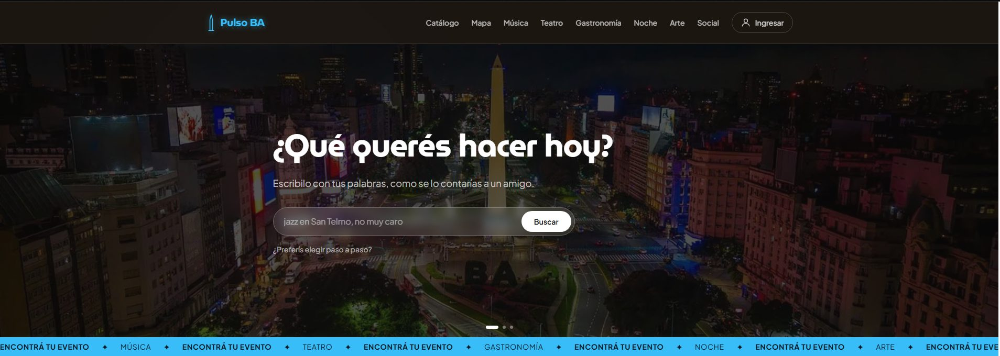
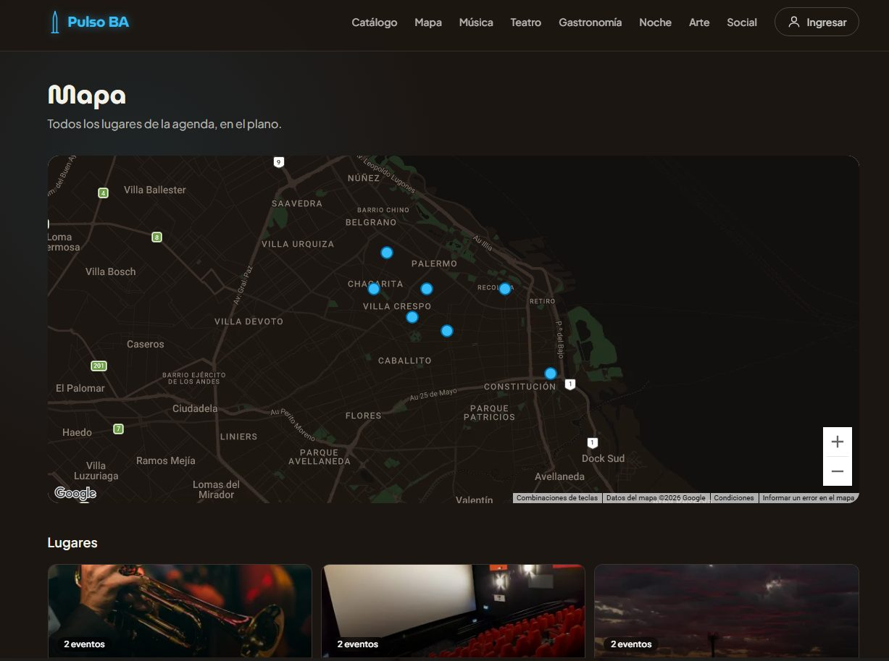

# Pulso BA

A guide to what's happening in Buenos Aires (music, theater, food, nightlife, art) that you can browse by *vibe*, not only by date or category.

**Live demo:** https://pulso-ba.vercel.app  ·  [Versión en español](README.es.md)

> The events and venues are made-up demo data. Photos come from Unsplash (credits in each event's data and in `src/lib/photoCredits.ts`).



| Explore by vibe | Venues on the map |
| --- | --- |
|  |  |

## Why I built it

I'm a junior frontend developer and I come from QA. I wanted a portfolio project that wasn't a todo list: something where I'd have to make real decisions. Where does the data live? How do I validate it? What happens when a third-party service goes down? How does auth work with server components?

Buenos Aires events were an easy topic to care about, and "vibe" (a mood like *jazz de sótano* or *domingo de feria*) turned out to be a fun way to browse them.

## What you can do

- **Ask in plain Spanish**, like "algo barato en Palermo con música en vivo". Gemini turns the sentence into filters (budget, category, neighborhood, keywords). If you'd rather click, a short wizard asks for budget, type of plan and neighborhood.
- **Explore by vibe.** Eight vibes, each with its own color palette. Every card links to the catalog already filtered.
- **Browse the catalog.** Filters live in the URL (`?category=`, `?vibe=`, `?neighborhood=`), so any filtered view can be shared.
- **Open an event** to see the lineup, tags, price, and a map zoomed in on the venue.
- **See every venue on one map** (Google Maps with a custom dark style). Each pin links to that neighborhood's events.
- **Create an account** (email + password, with password reset), then save favorites, mark "Voy" (I'm going), and leave one review per event. Reviews are editable.

## Stack

| | |
|---|---|
| Framework | Next.js 16 (App Router, Turbopack), React 19 |
| Language | TypeScript (strict) |
| Styling | Tailwind CSS v4, Framer Motion for the wizard step transitions |
| Validation | Zod 4 |
| i18n | next-intl 4 (Spanish UI for now, see "Not done yet") |
| Auth + database | Supabase (Postgres, Row Level Security, `@supabase/ssr`) |
| Maps | Google Maps JavaScript API |
| AI search | Google Gemini (`gemini-2.5-flash`) |
| Hosting | Vercel |

## Decisions worth explaining

**Zod schemas are the single source of truth.** Types come from `z.infer`, so there's no separate interface to keep in sync. Data is validated when the app loads it, and a broken record fails fast with a clear message (for example, an event pointing to a venue that doesn't exist).

**A data layer that doesn't leak.** Components never import the JSON files. They call `getEvents()` or `getEventBySlug()`, which are already `async`, so moving events to a database later doesn't touch the UI. To be honest about where it stands today: events, venues and vibes are still local JSON. Only the community features (favorites, attendance, reviews) use Supabase. Because of that, those tables store `event_id` as plain text instead of a foreign key.

**I don't trust the AI's output.** The Gemini prompt lists the exact categories and neighborhoods allowed, and the response is parsed with a Zod schema before it touches any filter. The `/api/search` route also has a small per-IP rate limit (12 requests a minute). It's in memory, so it won't hold across serverless instances. That's fine for a demo, and I'd move it to something like Redis in production. If the AI is down, slow or not configured, the search falls back to a local keyword matcher and the user never sees an error.

**Every external service can be missing without breaking the site.** No Maps key: the map shows a message. Google rejects the key (for example, a domain that isn't allowed): the map shows a friendly message instead of Google's gray error box. No Supabase variables: login and community features simply don't render. No Gemini key: search still works with keywords.

This one came from a real bug. A badly pasted environment variable once made the whole site return a 500, because the Supabase session refresh in `proxy.ts` had no error handling. Now Supabase failures are caught in the proxy, in `getCurrentUser()`, and in every auth action, and the rest of the site keeps working.

**Auth details.**
- Sessions live in cookies (`@supabase/ssr`). In Next.js 16 the old `middleware.ts` is `proxy.ts`, and that's where the session gets refreshed.
- Server Actions return `{ error }` or `{ info }` instead of throwing, so messages are shown in Spanish next to the form.
- `redirect()` works by throwing an exception, so it sits *outside* the `try/catch` blocks. If it were inside, it would be swallowed.
- "Forgot password" answers the same way whether the email exists or not, so the form can't be used to find out who has an account.
- The auth callback only accepts internal paths in `?next=`, to avoid an open redirect.

**Row Level Security does the heavy lifting.** Everything is publicly readable (to show counters and reviews), and each user can only write or delete their own rows. The SQL is in [`supabase/schema.sql`](supabase/schema.sql).

**Supabase's free plan pauses idle projects.** After about a week without requests the project pauses and the login breaks. A Vercel cron job (`vercel.json`) opens `/api/health` once a day. That route runs a tiny query, which counts as activity. It also returns a 503 if the database is unreachable, so opening it in the browser is a quick check.

**Small things I cared about.** The entrance animations are pure CSS, and their last keyframe is `opacity: 1`, so content can never get stuck invisible if something fails. Focus rings are explicit and visible, and the hero slider stops if the user has "reduce motion" turned on. Pages are Server Components by default; client components are only where there's real interaction (the hero wizard, the map, forms, the toggle buttons).

## Run it locally

You need Node.js 20.9 or newer.

```bash
git clone https://github.com/IgnacioDN/PULSO-BA.git
cd PULSO-BA
npm install
cp .env.example .env.local   # fill in what you have, all of it is optional
npm run dev                  # http://localhost:3000
```

Other scripts: `npm test` (Vitest: filters, schemas, formatting, demo data), `npm run typecheck`, `npm run lint` and `npm run build`. The same checks run on every push with GitHub Actions.

Without any keys the catalog, filters, event pages and keyword search all work. Each key unlocks one thing:

| Variable | Unlocks | Where to get it |
|---|---|---|
| `NEXT_PUBLIC_GOOGLE_MAPS_API_KEY` | Maps | Google Cloud → enable *Maps JavaScript API* |
| `GEMINI_API_KEY` | Natural-language search | Google AI Studio |
| `NEXT_PUBLIC_SUPABASE_URL` + `NEXT_PUBLIC_SUPABASE_ANON_KEY` | Login, favorites, "Voy", reviews | Supabase → Project Settings |

**Supabase setup**
1. Create a project and run [`supabase/schema.sql`](supabase/schema.sql) in the SQL Editor.
2. Copy the Project URL (no `/rest/v1/` at the end) and the *publishable* key.
3. For a quick demo, turn off **Confirm email** under Authentication → Sign In / Providers → Email. The free plan only sends a few emails per hour.
4. If you keep confirmation on, set the **Site URL** under Authentication → URL Configuration to your deployed URL and add `https://your-domain/**` to **Redirect URLs**. The confirmation and password-reset links depend on it.

**Google Maps key.** Restrict it by HTTP referrer. For local development use `http://localhost:3000/*`, and for Vercel use your domain (plus `https://*.vercel.app/*` if you want preview deployments to show the map).

## Project structure

```
src/
  app/
    [locale]/        pages: home, events, events/[slug], map, auth, auth/reset
    api/             search (Gemini), health (Supabase heartbeat), auth/callback
  components/        auth, events, home, layout, map, ui
  lib/
    schemas.ts       Zod schemas and the types derived from them
    data.ts          data layer (JSON today, a database tomorrow)
    filterEvents.ts  filters and keyword search, pure functions
    actions/         Server Actions: auth and community
    supabase/        browser client, server client, config helpers
  data/              events.json, venues.json, vibes.json
  proxy.ts           locale handling + Supabase session refresh
messages/            es.json
supabase/            schema.sql
```

## Not done yet

- **No automated tests.** This is the biggest gap. Next up: unit tests for the filters and schemas, and a Playwright end-to-end test for the main flow (search → event → login).
- **English UI.** Event content is already bilingual in the schema (`{ es, en }`) and next-intl is set up, but only `messages/es.json` exists.
- **Real events.** Everything is demo data. The data layer is ready to read from a database.
- **Reviews store the author's email.** The UI only shows the first letters, but the column is publicly readable through the API. The fix is to store a display name instead.

## About me

Frontend developer with React and TypeScript, with 3+ years working in ecommerce on Adobe Commerce (Magento). My QA background shows in how I build: I care about edge cases, accessibility and failure states. I turn designs into responsive, reusable interfaces and work well with design and business teams. Pulso BA is my latest project: a full-stack Next.js app with auth, AI search and a database.

## License

No license yet, so all rights reserved for now.
